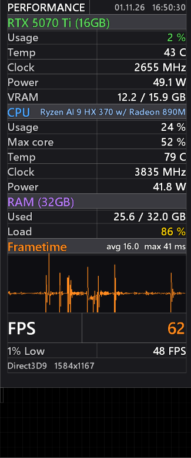

# TrueFrame Overlay

**An overlay for RivaTuner Statistics Server (RTSS) that shows your *real* FPS when frame generation is on, plus a smooth frametime graph and the sensors that matter. One-click install, nothing else needed.**

[Русская версия](README.ru.md) · [How it works](docs/how-it-works.md) · [Changelog](CHANGELOG.md)



## Why

With DLSS Frame Generation and similar technologies, a normal FPS counter shows the *generated* frame rate. "120 FPS" on screen can mean only 60 frames actually rendered by the game, and input latency follows the real number.

TrueFrame detects frame generation automatically and shows both numbers: **`120 (60)`** = displayed (real). Without frame generation you simply see one number.

## Features

- **Displayed and real FPS.** The real value in brackets appears only while frame generation is detected.
- **1% Low** FPS.
- **Frametime graph** of the frames that actually reached the screen, with average and worst frame time. Scrolls smoothly.
- **GPU:** load, temperature, clock, power, VRAM. **CPU:** load, busiest core, temperature, clock, power. **RAM:** used and load.
- Hardware names are filled in automatically for every PC.
- Yellow and red warnings for high temperatures and loads.
- Presets for **1080p, 1440p and 4K**, the same proportions on every screen.
- **Only RTSS is required.** No HWiNFO, no MSI Afterburner.
- One-click install and uninstall, your previous RTSS settings are backed up.

## Requirements

- Windows 10 or 11.
- [RivaTuner Statistics Server](https://www.guru3d.com/download/rtss-rivatuner-statistics-server-download/) 7.3 or newer (tested with 7.3.5). RTSS is not included in this project, please download it from the official Guru3D page.

## Install

1. Install RTSS.
2. Download the latest release from the [Releases](https://github.com/apbrandom/trueframe-overlay/releases) page and unzip it.
3. Double-click **`install.cmd`** and allow the administrator prompt (RTSS lives in Program Files).
4. Choose your game resolution. Your screen resolution is detected and offered by default.
5. Start a game. Show or hide the overlay with **Ctrl+Shift+F10**.

To remove it, double-click **`uninstall.cmd`**. It restores the RTSS settings saved before the first install.

## Changing the resolution

The overlay text size is tuned for each resolution, so use the matching preset. The installer puts **all three presets** into RTSS, so you can switch at any time:

- **Run `install.cmd` again** and pick the other resolution (about 10 seconds), or
- **In RTSS:** open *Setup → Plugins → OverlayEditor → Setup*, then *Layouts → Load* and select `TrueFrame_1080p.ovl`, `TrueFrame_1440p.ovl` or `TrueFrame_4k.ovl` from `RTSS\Plugins\Client\Overlays`.

The overlay does not scale itself to the game's resolution: RTSS layouts use fixed pixel sizes, so the three presets are tuned by hand. If you play different games at different resolutions, switch the preset when you switch the game.

<details>
<summary>What exactly does the installer change?</summary>

- Copies the three layouts to `RTSS\Plugins\Client\Overlays\TrueFrame_*.ovl` and makes the one you chose the active OverlayEditor layout.
- Enables the OverlayEditor and HotkeyHandler plugins.
- Sets the OSD show/hide hotkey. If you already have one, it asks before replacing it.
- Saves a copy of every changed RTSS file as `*.overlay-backup` (first install only), then restarts RTSS.

Advanced options (run in PowerShell from the project folder):

| Command | What it does |
|---|---|
| `.\install.ps1 -DryRun` | Shows what would be changed, changes nothing |
| `.\install.ps1 -Resolution 1440` | Skips the resolution question (`1080`, `1440`, `2160`) |
| `.\install.ps1 -Hotkey "Ctrl+Alt+O"` | Another hotkey. `keep` leaves yours untouched, `none` clears it |
| `.\install.ps1 -RtssPath "D:\RTSS"` | RTSS installed in a non-standard folder |

</details>

**Manual install:** in RTSS open *Setup → Plugins → OverlayEditor → Setup*, then *Layouts → Load* and pick a file from the `overlays` folder.

## Known limitations

- **Frame generation detection needs about 10 seconds** after you switch it on or off: it analyses the last 1024 frames.
- **The graph and the avg/max numbers are 3 seconds behind** by design. PresentMon, which provides the frame data, reports frames in batches with a variable lag; showing them with a fixed delay is what makes the graph scroll smoothly. The big FPS number is live.
- **Counter-Strike 2 and games with strict anti-cheat** may block the RTSS overlay. According to the RTSS documentation, CS2 also does not support RTSS's native frame rate counter, so the FPS number may stay empty there.
- This is a beta tested on one PC (RTX 5070 Ti, Ryzen AI 9 HX 370). The current frame generation algorithm is validated on simulated frame data for 2x to 4x. Reports from other hardware and games are very welcome.

## Reporting a problem

Open an [issue](https://github.com/apbrandom/trueframe-overlay/issues/new/choose). The fastest way to get help: load the **debug** layout for your resolution (`overlays/TrueFrame_<resolution>_debug.ovl`), play for 30 seconds and attach a screenshot. Its extra lines show what the overlay has detected. A short *game compatibility report* is just as useful.

## Building from source

All layouts are generated by one script, so the presets never drift apart:

```
python tools/make_overlay.py --all overlays
```

## Credits

- [RivaTuner Statistics Server](https://www.guru3d.com/download/rtss-rivatuner-statistics-server-download/) by Alexey Nicolaychuk (Unwinder). TrueFrame is a layout for its OverlayEditor plugin and contains no RTSS code or files.
- [PresentMon](https://github.com/GameTechDev/PresentMon) by Intel, shipped with RTSS, provides the frame timing data.
- This project is not affiliated with Guru3D, MSI, NVIDIA or Intel.

## About

Made by Vadim ([@apbrandom](https://github.com/apbrandom)). Developed with the help of an AI assistant (Claude by Anthropic); the problem definition, design decisions and in-game testing are mine.

## License

[MIT](LICENSE)
