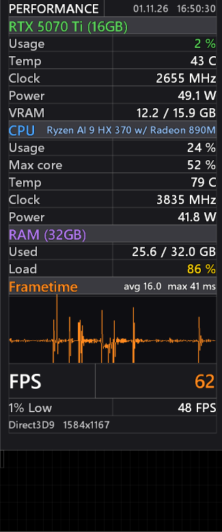

# TrueFrame Overlay

**Показывает *реальный* FPS при включённой генерации кадров.** Оверлей для RivaTuner Statistics Server (RTSS): FPS на экране и реальный, 1% Low, плавный график времени кадра и важные датчики видеокарты, процессора и памяти.

[English](README.md) · **Русский**

## Установка

Нужен Windows 10 или 11. Займёт около двух минут.

1. **Установите RTSS** с [официальной страницы Guru3D](https://www.guru3d.com/download/rtss-rivatuner-statistics-server-download/).
   Нужен именно *RivaTuner **Statistics Server***, а не старый *RivaTuner v2.24*. Уже стоит MSI Afterburner? Обычно RTSS ставится вместе с ним, этот шаг можно пропустить.
2. **Скачайте TrueFrame** и распакуйте:

   <!-- обновлять версию в этой ссылке при каждом релизе -->
   

3. **Запустите `install.cmd`** в распакованной папке и нажмите **Да**, когда Windows спросит права администратора.
   Если Windows предупредит о скачанном файле, нажмите *Запустить* (или *Подробнее → Выполнить в любом случае*).
4. **Ответьте на два вопроса** (они на английском):
   - `Choose 1-3`: разрешение, в котором играете. Enter = найденное автоматически.
   - `Choose 1-2`: язык оверлея, **2 = русский**.
5. **Запустите игру.** Оверлей появится сам. **Ctrl+Shift+F10** показывает и скрывает его.

Удалить TrueFrame: запустите **`uninstall.cmd`**. Он вернёт прежние настройки RTSS.

Что-то пошло не так? Смотрите [Проблемы и решения](#проблемы-и-решения).

## Зачем

С DLSS Frame Generation и похожими технологиями счётчик FPS показывает частоту *с учётом сгенерированных* кадров: «120 FPS» может означать, что игра реально отрисовала только 60, а задержка ввода соответствует реальному числу.

TrueFrame сам определяет генерацию кадров и показывает оба числа: **`120 (60)`** = на экране (реально). Без генерации кадров отображается одно число.

## Возможности

- **FPS на экране и реальный.** Реальный в скобках появляется, только когда обнаружена генерация кадров.
- **1% Low.**
- **График времени кадра** по кадрам, которые реально дошли до экрана, со средним и худшим значением. Идёт плавно.
- **Видеокарта:** загрузка, температура, частота, потребление, видеопамять. **Процессор:** загрузка, самое загруженное ядро, температура, частота, потребление. **ОЗУ:** занято и загрузка. Названия железа подставляются на любом ПК.
- **Жёлтые и красные предупреждения** при высокой температуре и загрузке.
- **Пресеты под 1080p, 1440p и 4K** с одинаковыми пропорциями на любом экране.
- **Русский или английский**, выбирается при установке.
- **Нужен только RTSS.** Без HWiNFO и MSI Afterburner. Прежние настройки RTSS сохраняются.

## Как сменить разрешение или язык

Запустите `install.cmd` ещё раз и выберите другое разрешение или язык. Это около 10 секунд.

Все пресеты уже лежат в RTSS, поэтому переключиться можно и там: *Setup → Plugins → OverlayEditor → Setup → Layouts → Load*, затем выберите файл в `RTSS\Plugins\Client\Overlays`: `TrueFrame_1080p_ru.ovl`, `TrueFrame_1440p_ru.ovl` или `TrueFrame_4k_ru.ovl` для русского, то же имя без `_ru` для английского.

Оверлей не подстраивается под разрешение сам: макеты RTSS используют фиксированный размер в пикселях. Если играете в разные игры в разных разрешениях, переключайте пресет вместе с игрой.

## Проблемы и решения

- **«Невозможно загрузить драйвер RivaTuner64.sys» или окно «RivaTuner v2.24».** Это не та программа: старый настройщик видеокарт 2008 года с похожим названием. Удалите его, перезагрузите Windows и установите RTSS ([шаг 1](#установка)). Отключать проверку подписи драйверов не нужно.
- **«RTSS was not found».** Сначала установите RTSS. Если он стоит в нестандартной папке, запустите в PowerShell из папки TrueFrame: `.\install.ps1 -RtssPath "D:\RTSS"`.
- **«MSI Afterburner is running».** Закройте Afterburner (проверьте и значок в трее) и запустите `install.cmd` ещё раз.
- **Выбрали русский, а оверлей на английском.** Установщику не удалось нарисовать русские слова, и он поставил английский вариант. Пожалуйста, [создайте issue](https://github.com/apbrandom/trueframe-overlay/issues/new/choose) со скриншотом окна установщика.
- **В игре нет оверлея.** Нажмите **Ctrl+Shift+F10**, проверьте, что RTSS запущен (значок в трее), и прочитайте ниже про античит.

## Ограничения

- **Генерация кадров определяется примерно за 10 секунд** после включения или выключения: анализируются последние 1024 кадра.
- **График и цифры avg/max отстают на 3 секунды** специально. PresentMon, который даёт данные о кадрах, присылает их пачками с переменной задержкой; фиксированная задержка делает прокрутку плавной. Большая цифра FPS показывается в реальном времени.
- **Counter-Strike 2 и игры со строгим античитом** могут блокировать оверлей RTSS. По документации RTSS, CS2 к тому же не поддерживает встроенный счётчик FPS RTSS, поэтому число FPS там может быть пустым.
- **Бета, проверена на одном ПК** (RTX 5070 Ti, Ryzen AI 9 HX 370). Видеокарты AMD и Intel должны работать, но не проверены. Алгоритм определения генерации кадров проверен на смоделированных данных для 2x–4x. Отчёты с другого железа и из других игр очень помогут.

## Сообщить о проблеме

Создайте [issue](https://github.com/apbrandom/trueframe-overlay/issues/new/choose). Быстрее всего помогает скриншот с **debug**-версией для вашего разрешения (`overlays/TrueFrame_<разрешение>_debug.ovl`) после 30 секунд игры: в дополнительных строках видно, что определил оверлей.

## Подробнее

- [Как это работает](docs/how-it-works.md) (на английском): определение генерации кадров, 1% Low, график, почему русские слова нарисованы картинками.
- [Список изменений](CHANGELOG.md) (на английском)

Что именно меняет установщик?

- Копирует английские пресеты в `RTSS\Plugins\Client\Overlays\TrueFrame_*.ovl`, рисует там же русские (`TrueFrame_*_ru.ovl` и маленькие картинки `TrueFrame_*_ru.png` со словами) и делает выбранный активным.
- Создаёт файлы настроек RTSS, которых ещё нет на только что установленном RTSS.
- Включает плагины OverlayEditor и HotkeyHandler.
- Ставит горячую клавишу показа оверлея. Если у вас уже есть своя, спросит перед заменой.
- Сохраняет копии изменённых файлов RTSS как `*.overlay-backup` (только при первой установке) и перезапускает RTSS.

Посмотреть изменения без применения: `.\install.ps1 -DryRun`. Остальные параметры описаны в [английском README](README.md#more).

**Вручную (только английский):** в RTSS *Setup → Plugins → OverlayEditor → Setup → Layouts → Load* и выберите файл из папки `overlays`. Русскому оверлею нужен установщик: слова рисуются на вашем ПК.

## Благодарности

- [RivaTuner Statistics Server](https://www.guru3d.com/download/rtss-rivatuner-statistics-server-download/), автор Алексей Николайчук (Unwinder). TrueFrame это раскладка для его плагина OverlayEditor, код и файлы RTSS в проект не входят.
- [PresentMon](https://github.com/GameTechDev/PresentMon) от Intel, поставляется вместе с RTSS, даёт данные о кадрах.
- Проект не связан с Guru3D, MSI, NVIDIA или Intel.

## Автор

Вадим ([@apbrandom](https://github.com/apbrandom)). Разработано с помощью ИИ-ассистента (Claude от Anthropic); постановка задачи, решения по дизайну и тестирование в играх мои.

## Лицензия

[MIT](LICENSE)
